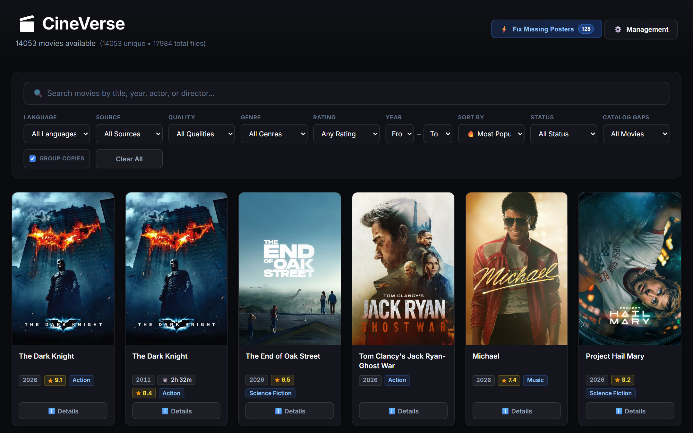
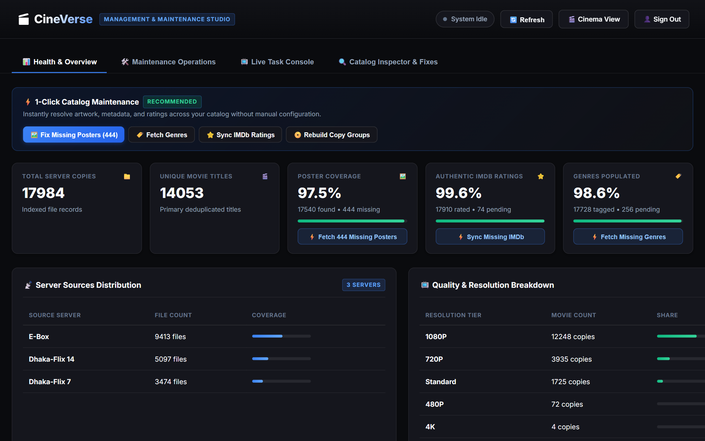

<p align="center">
  
  
  
  
  
  
  
  
</p>

# 🎬 CineVerse

> **Turn raw folder indexes and private storage into a fast, curated personal cinema web app.**  
> Built for Home Labs, NAS devices, Seedboxes, ISP/BDIX FTP servers, and H5AI directory listings — with support for both local SQLite and cloud PostgreSQL (Supabase / Render).

---

<p align="center">
  
</p>

---

## ✨ Features at a Glance

| Feature | Highlight |
|---|---|
| 🎨 **Obsidian Cinema UI** | Dark glass interface with instant AJAX search, multi-facet filters, and mobile/tablet/desktop responsiveness. |
| 🎬 **In-Modal YouTube Trailers** | Embedded 16:9 trailer player alongside cast, director, synopsis, release date, and runtime details. |
| ⭐ **Authentic IMDb Ratings** | Resolves canonical IMDb IDs (`tt...`) and ratings with Cinemeta/IMDb support, preventing vote bias. |
| 🌐 **True Native Language** | Uses TMDB/IMDb original language metadata rather than noisy folder-path heuristics. |
| 📀 **Smart Copy Deduplication** | Groups multi-server and multi-resolution (`4K`, `1080p`, `720p`) copies into a single card with a stream switcher. |
| ⚡ **Remote-Postgres Tuned** | Single-query window pagination (`COUNT(*) OVER ()`), cached homepage catalog metrics, GZip responses, and PostgreSQL `pg_trgm` GIN + partial B-tree sort indexes. |
| 🔒 **Protected Studio (`/manage/`)** | Public catalog browsing with staff/token-gated management actions (`MANAGE_REQUIRE_AUTH`), task progress console, and portable `.json.gz` backup/restore. |
| 🩺 **Production Readiness** | Built-in `/health/` database connectivity probe, persistent TCP keepalives, and deterministic CI/CD. |

---

## ⚡ Quickstart (Local SQLite)

### 1. Clone, Install & Configure

```bash
git clone https://github.com/nafisshahriar/CineVerse.git
cd CineVerse
python -m venv .venv

# Windows: .venv\Scripts\activate
# Linux / macOS: source .venv/bin/activate
pip install -r requirements.txt
cp .env.example .env
```

Edit `.env` to set `DJANGO_SECRET_KEY`, `DJANGO_SUPERUSER_USERNAME`, `DJANGO_SUPERUSER_PASSWORD`, and your free `TMDB_API_KEY` from [themoviedb.org](https://www.themoviedb.org/settings/api).

### 2. Initialize Database & Admin Account

```bash
python manage.py migrate
python manage.py ensure_admin
```

### 3. Crawl Your Media Directory & Launch

```bash
# Scan an H5AI / HTTP directory listing and enrich TMDB + IMDb metadata:
python manage.py update_all --url "http://your-nas-or-h5ai-server/movies/"

# Start the web server:
python manage.py runserver
```

Open **`http://localhost:8000`** in your browser (or visit **`http://localhost:8000/manage/`** for the Management Studio).

<p align="center">
  
</p>

---

## 🌐 Hybrid Architecture (Local Storage + Cloud UI)

If your media files reside on a private LAN, home NAS, or local ISP FTP (`172.16.x.x` / `10.x.x.x`) that cloud hosts cannot reach directly:

```text
 [ Phone / Tablet / TV / PC on LAN ]
        │
        ├── 1. Browses catalog & metadata (HTTPS) ──► [ CineVerse App (Render) ]
        │                                                       │
        │                                                       ▼
        │                                             [ Cloud PostgreSQL (Supabase) ]
        │                                                       ▲
        └── 2. Streams video directly at LAN speed ──► [ Local NAS / H5AI / FTP ]
                                                                ▲
                                                (Optional local PC crawl + push_local_to_online)
```

- **Zero Bandwidth Overhead:** CineVerse stores metadata and stream URLs; playback goes directly from your media server to your browser/player.
- **Two Sync Workflows:**
  - **Direct Cloud Sync (`DATABASE_URL` set in local `.env`):** Local crawls (`crawl_h5ai`, `update_all`, or `http://localhost:8000/manage/`) write **directly to Supabase / cloud PostgreSQL**, so Render shows new movies right away without running `push_local_to_online` (note: your local `db.sqlite3` file stays untouched while `DATABASE_URL` is active).
  - **Offline SQLite + Push (`DATABASE_URL` blank in local `.env`):** Run crawls fast locally against `db.sqlite3`, then push deltas cleanly into Supabase / cloud PostgreSQL without overwriting admin users:

```bash
# Merge/upsert local SQLite catalog into DATABASE_URL (safe incremental sync):
python manage.py push_local_to_online

# Or replace all catalog rows cleanly while preserving Django admin accounts:
python manage.py push_local_to_online --replace
```

You can also export and restore `.json.gz` portable catalog snapshots directly inside **`/manage/`** without touching `auth_user` credentials.

---

## ☁️ Deployment Options

### Option 1: Render.com + Supabase PostgreSQL (Free Cloud Stack)

CineVerse includes [`render.yaml`](render.yaml), [`build.sh`](build.sh), [`Procfile`](Procfile), and [`/health/`](movies/urls.py) out of the box.

1. Create a PostgreSQL database (for example on **[Supabase](https://supabase.com/)**). Copy the **Session Pooler** URI (port `5432`, IPv4-compatible for Render/serverless):
   ```env
   DATABASE_URL=postgresql://postgres.<project-ref>:<password>@aws-0-<region>.pooler.supabase.com:5432/postgres
   ```
2. On **[Render.com](https://render.com/)**, create a **Web Service** (or Blueprint from `render.yaml`) pointing to your fork:
   - **Build Command:** `./build.sh`
   - **Start Command:** `gunicorn moviedash.wsgi:application --bind 0.0.0.0:$PORT --workers 1 --threads 8 --timeout 120 --log-file -`
   - **Health Check Path:** `/health/`
3. Add environment variables (`DJANGO_SECRET_KEY`, `DJANGO_DEBUG=False`, `MANAGE_REQUIRE_AUTH=True`, `DATABASE_URL`, `DJANGO_SUPERUSER_USERNAME`, `DJANGO_SUPERUSER_PASSWORD`, `TMDB_API_KEY`).

On deploy, `./build.sh` automatically collects static assets, applies schema and PostgreSQL `pg_trgm` / partial B-tree index migrations (`0013_postgres_search_and_sort_indexes`), and ensures your admin user exists.

### Option 2: Docker & Docker Compose

```bash
cp .env.example .env
# Edit .env with your secret key, TMDB key, and optional DATABASE_URL
docker compose up -d --build
```

- Stores local SQLite persistently inside `./data/db.sqlite3` via `SQLITE_DB_PATH=/app/data/db.sqlite3` (or connects to `DATABASE_URL` when set).
- Includes a built-in container `healthcheck` polling `http://127.0.0.1:8000/health/`.

### Option 3: Raspberry Pi / Linux `systemd`

Template units live under [`pi_deployment/`](pi_deployment/):

1. Edit paths/user in [`pi_deployment/cineverse.service`](pi_deployment/cineverse.service) (defaults to `/home/pi/CineVerse` and user `pi`).
2. Copy the unit and start the service:
   ```bash
   sudo cp pi_deployment/cineverse.service /etc/systemd/system/cineverse.service
   sudo systemctl daemon-reload
   sudo systemctl enable --now cineverse
   ```
3. [`pi_deployment/cineverse_startup.sh`](pi_deployment/cineverse_startup.sh) runs migrations, `collectstatic`, `ensure_admin`, and launches Gunicorn.

---

## ⚙️ Environment Variables

See [`.env.example`](.env.example) for a complete template:

| Variable | Default | Purpose |
|---|---|---|
| `DJANGO_SECRET_KEY` | dev fallback | Cryptographic signing key (**required** in production). |
| `DJANGO_DEBUG` | `True` | Set `False` in production. |
| `DJANGO_ALLOWED_HOSTS` | `*` | Comma-separated allowed hostnames (`RENDER_EXTERNAL_HOSTNAME` auto-appended). |
| `DATABASE_URL` | *(empty)* | PostgreSQL connection URI; blank uses local SQLite. |
| `SQLITE_DB_PATH` | `./db.sqlite3` | Custom SQLite file path (used by Docker Compose). |
| `DB_CONN_MAX_AGE` | `60` | Persistent DB connection reuse TTL in seconds (`conn_health_checks=True`). |
| `DB_CONNECT_TIMEOUT` | `10` | PostgreSQL socket connect timeout in seconds. |
| `CATALOG_STATS_CACHE_SECONDS` | `60` | Homepage catalog metrics cache TTL in seconds (`LocMemCache`). |
| `MANAGE_REQUIRE_AUTH` | `not DEBUG` | Require staff login or `MANAGE_SECRET_TOKEN` on `/manage/` and its APIs. |
| `MANAGE_SECRET_TOKEN` | *(empty)* | Optional token passed via `X-Manage-Token` header or `?token=` query param. |
| `DJANGO_SUPERUSER_USERNAME` | *(empty)* | Admin username provisioned by `ensure_admin`. |
| `DJANGO_SUPERUSER_PASSWORD` | *(empty)* | Admin password provisioned by `ensure_admin`. |
| `DJANGO_SUPERUSER_EMAIL` | `admin@cineverse.local` | Admin email provisioned by `ensure_admin`. |
| `TMDB_API_KEY` | *(empty)* | TMDB v3 API key for posters, cast, trailers, and metadata. |
| `OMDB_API_KEY` | *(empty)* | Optional OMDb API fallback key for IMDb lookup. |

---

## 🛠️ Essential Management Commands

```bash
# Crawl an H5AI server directory and import movies
python manage.py crawl_h5ai --url "http://your-nas/movies/" --source "Home NAS"

# Full crawl + metadata + detail enrichment pipeline
python manage.py update_all --url "http://your-nas/movies/"

# Fetch missing posters & TMDB details in parallel (add --missing-details for movies lacking MovieDetail)
python manage.py fetch_missing_metadata --workers 4 --missing-details

# Multi-threaded IMDb ratings & genre sync
python manage.py fetch_imdb_ratings --all --workers 8
python manage.py fetch_genres --all --workers 8

# Sync local SQLite catalog into remote DATABASE_URL (Supabase/Postgres)
python manage.py push_local_to_online

# Reset catalog tables cleanly (keeps admin accounts intact)
python manage.py reset_catalog --yes

# Create or update the superuser account from env vars or flags
python manage.py ensure_admin --username admin --password "StrongPassword123!"
```

---

## 📁 Repository Structure

```text
CineVerse/
├── .github/workflows/ci.yml   # GitHub Actions (Python 3.11 & 3.12 CI + Render CD hook)
├── moviedash/                 # Django project config, middleware, DB/cache setup, root URLs
├── movies/
│   ├── management/commands/   # Crawlers, metadata enrichers, DB sync & admin utilities
│   ├── migrations/            # Cross-DB (SQLite + PostgreSQL pg_trgm/partial indexes) migrations
│   ├── templates/movies/      # Public catalog, AJAX partial fragments, Management Studio
│   ├── cache_utils.py         # Catalog summary cache invalidation helpers
│   ├── models.py              # Movie, MovieDetail, MediaSource, CrawledDirectory, FailedParse
│   ├── pagination.py          # Single-query WindowCountPaginator (COUNT(*) OVER ())
│   ├── services.py            # TMDB search & unified metadata enrichment
│   ├── task_runner.py         # Background task manager with live stdout log/progress stream
│   ├── urls.py                # App endpoints including /health/ & /manage/api/*
│   ├── utils.py               # Title parser, language detector, Cinemeta/IMDb/OMDB helpers
│   └── views.py               # Filtering, sorting, AJAX modals, management & portable import/export
├── pi_deployment/             # Raspberry Pi systemd service & startup script
├── static/movies/styles.css   # Main stylesheet served via WhiteNoise
├── docs/screenshots/          # README screenshots
├── CONTRIBUTING.md            # Development & PR guidelines
├── Dockerfile / docker-compose.yml
├── Procfile / build.sh / render.yaml
└── requirements.txt
```

---

## 🧪 Running Tests & Contributing

Offline unit tests and migration checks run cleanly without external APIs or touching production databases:

```bash
python manage.py check
python manage.py makemigrations --check --dry-run
python manage.py test --exclude-tag=network -v 2
```

Contributions are welcome — see [`CONTRIBUTING.md`](CONTRIBUTING.md) for guidelines.

---

## 📄 License & Disclaimer

- **License:** Released under the **[MIT License](LICENSE)**.
- **Media Notice:** CineVerse is a personal catalog organizer (similar in concept to Plex or Jellyfin library indexes). It does **not** host, store, or distribute video files; stream URLs come solely from user-configured media directories.
